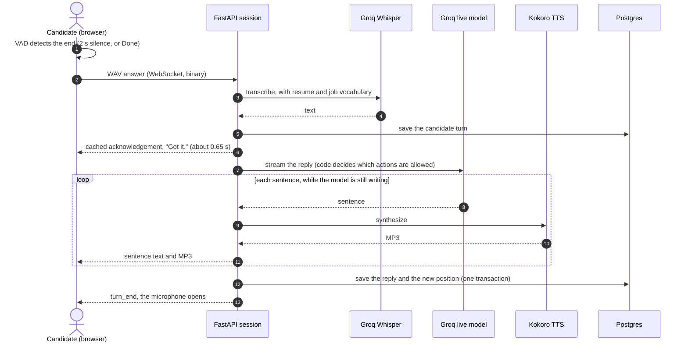
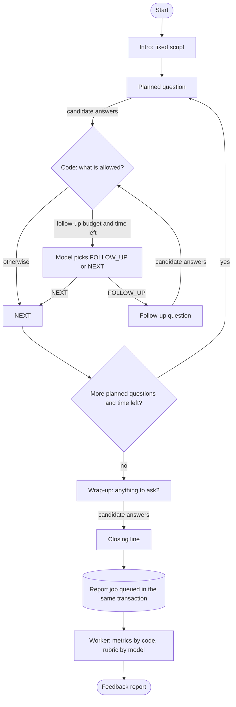

# AI Interviewer

Free, voice-based mock interviews personalized to your resume and a job description, with an evidence-based feedback report.

1. **Upload a resume**: parsed into structured data.
2. **Paste a job description**: match score, missing skills, stronger resume bullets.
3. **Practice the interview by voice**: an AI interviewer asks about *your* projects and *this* job's gaps, and follows up when an answer is vague.
4. **Get a report**: competency scores with quotes from your own answers, question-by-question feedback, and speaking metrics.

Everything runs on free tiers: Groq (LLM + Whisper), self-hosted Kokoro TTS, Supabase, Vercel, an Oracle Cloud free VM.

**No job description needed:** upload a resume and practice immediately, or paste a job description to focus the interview and get a match report.

**Grading:** scores are tied to quotes from your own answers; a strong score without proof is lowered by code, and every question gets a specific "missing" note and a model answer (D37).

**In the interview room:** live transcript, a pulsing indicator for whose turn it is, and "Done answering". You can end it by clicking **End interview** or by saying so ("I want to stop the interview"), and either works at any moment, even while the interviewer is speaking.

**Design decisions and architecture: [`projectprep.md`](projectprep.md)** (D1–D32, each with what was chosen, why, and what was given up).
Measured speech latency: [`docs/benchmarks/`](docs/benchmarks/). Deploying: [`docs/deploy.md`](docs/deploy.md). Launching: [`docs/launch.md`](docs/launch.md).

## Architecture

```
Browser (Next.js 16) ── HTTPS ──► FastAPI ──► Groq: gpt-oss-120b (plans, reports), gpt-oss-20b (live turns), Whisper
   mic → Silero VAD    ── WSS ───►  ├─ interview state machine (code owns structure, model writes words)
   gapless audio queue              ├─ Kokoro TTS, sentence by sentence while the model streams
                                    ├─ Postgres job queue (outbox + SKIP LOCKED) for reports
                                    └─► Supabase Postgres (RLS-locked) + Auth (JWT verified locally)
```

## How an interview works

**One turn**, from the candidate finishing an answer to the interviewer speaking again. The candidate hears an acknowledgement almost at once (the cached "Got it."), and each sentence of the reply is spoken while the model is still writing the rest (D8, D23). Measured: [`docs/benchmarks/`](docs/benchmarks/).



**The whole interview.** Code owns the structure and the model writes the words (D29): the model can only choose between a follow-up and moving on, inside what the code allows, and the next planned question is always spoken word for word. When the interview ends, the report job is queued in the same database transaction, so a report is never lost.



## Roadmap

Planned, **not implemented**. Nothing below is part of the architecture today:

- **LangGraph** to run the interview flow (checkpointing, a drawn graph) and **LangChain** as a provider layer. Today the flow is plain Python, on purpose: see decision D35 in [`projectprep.md`](projectprep.md) for why it was evaluated and what would change that.
- A fallback speech-to-text (`faster-whisper` on the VM) behind the existing `STTProvider` interface, for when Groq is at its free limit.
- A short wait-and-retry when the free model limit is hit, instead of failing straight away.
- Interruptions (talking over the interviewer), and more Indian languages with the AI4Bharat models.

## Repository

```
apps/api        FastAPI service (Python 3.12, uv): app/, tests/, bench/
apps/web        Next.js app (TypeScript, Tailwind, shadcn/ui): src/, e2e/
supabase/       SQL migrations, applied in order
infra/          docker-compose (local services, production stack), Caddyfile
docs/           benchmarks, deploy guide, launch checklist
```

## Run locally

Requires Python 3.12 + [uv](https://docs.astral.sh/uv/), Node 22+, Docker.

```bash
# Postgres (tests) + Kokoro TTS (the interviewer's voice; ~3 GB image)
docker compose -f infra/docker-compose.yml --profile speech up -d

# API: http://localhost:8000/docs
cd apps/api
cp .env.example .env          # GROQ_API_KEY, SUPABASE_URL, DATABASE_URL
uv sync && uv run uvicorn app.main:app --reload

# Web: http://localhost:3000
cd apps/web
cp .env.example .env.local    # Supabase URL + publishable key, API URL
npm install && npm run dev
```

Without Kokoro, interviews still work: the browser's built-in voice reads the questions (D26).
After changing API models, run `npm run gen:api` to regenerate the TypeScript types.

**Supabase login setup** (dashboard → Authentication): add `http://localhost:3000/auth/callback` to *Redirect URLs*; optionally enable *Google*.

**Migrations:** `bash scripts/db-push.sh` (`--dry-run` first to see what would change)

## Tests

| Suite | Command | Needs |
|---|---|---|
| API (unit + integration) | `cd apps/api && uv run pytest` | Local Postgres (`docker compose … up -d postgres`). Fakes for Groq, Whisper, Kokoro |
| API lint/format | `uv run ruff check && uv run ruff format --check` | none |
| Web types/lint/build | `cd apps/web && npx tsc --noEmit && npm run lint && npm run build` | none |
| End-to-end (real browser, fake mic) | `cd apps/web && npm run e2e` | The running stack + Supabase keys, see `e2e/support.ts` |

CI runs everything except end-to-end on every push and pull request.
