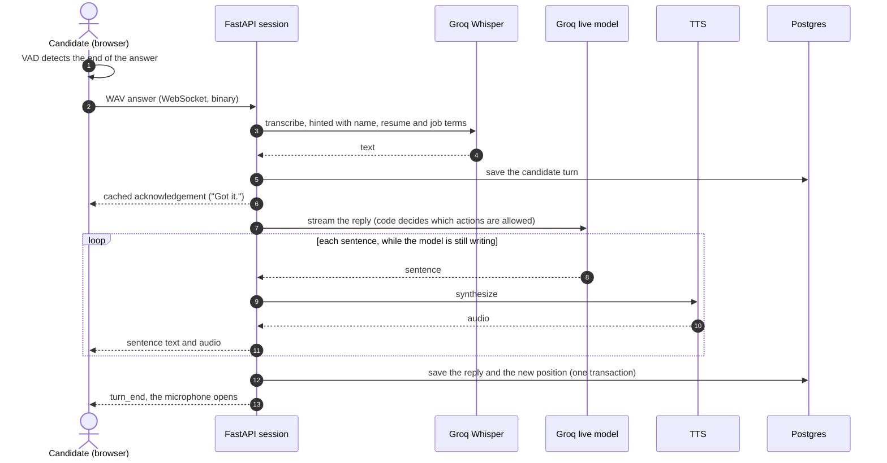
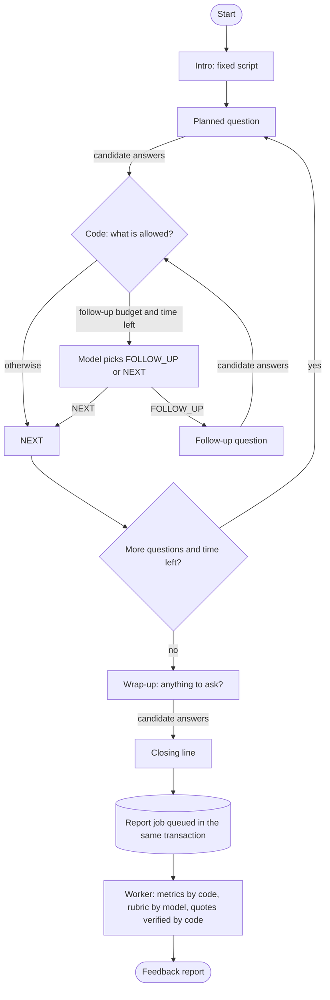
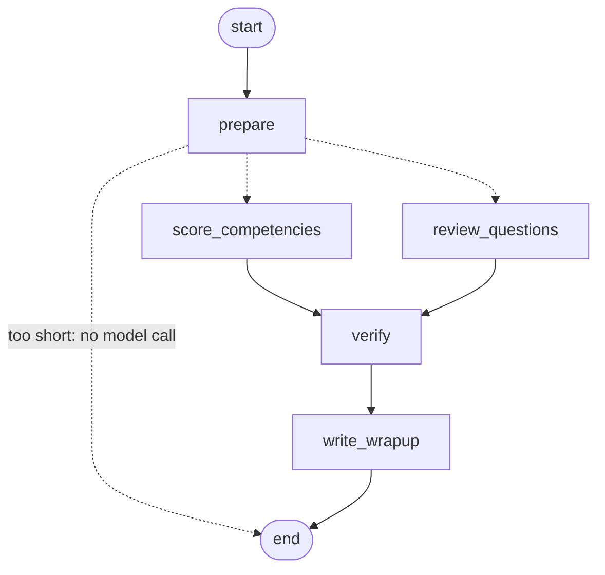
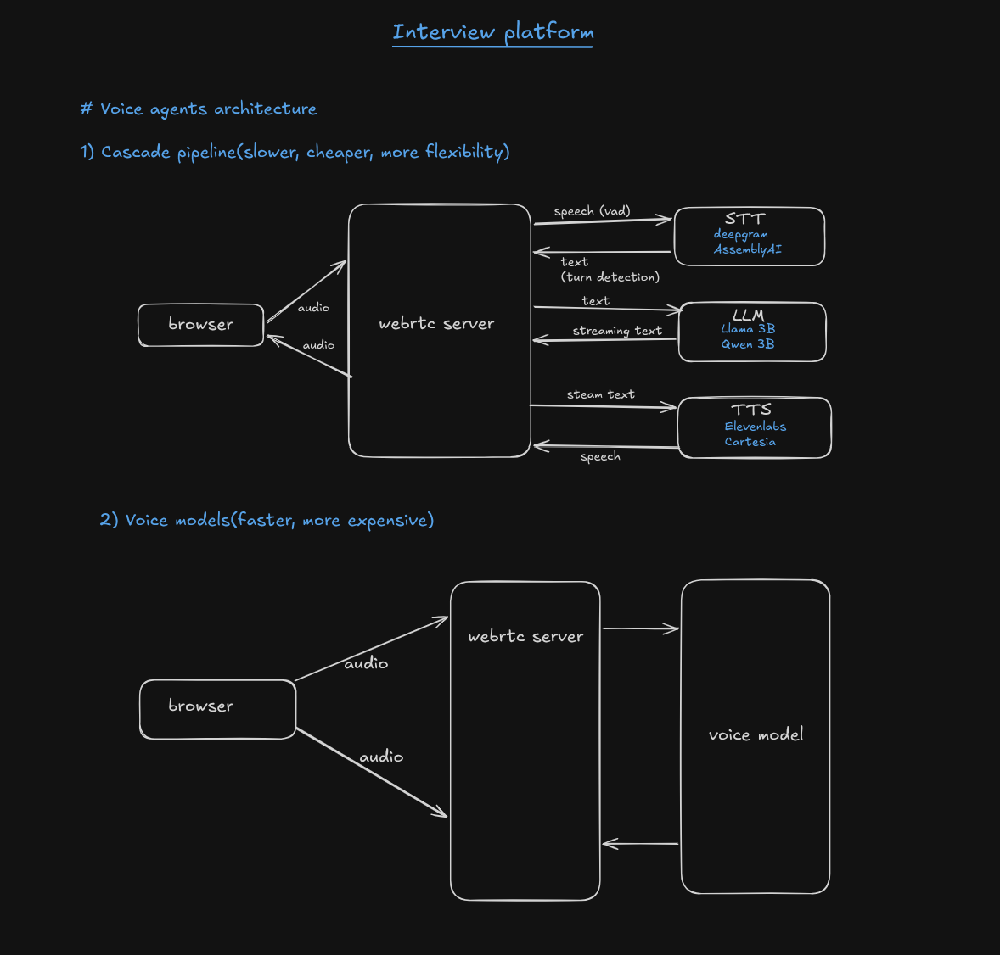
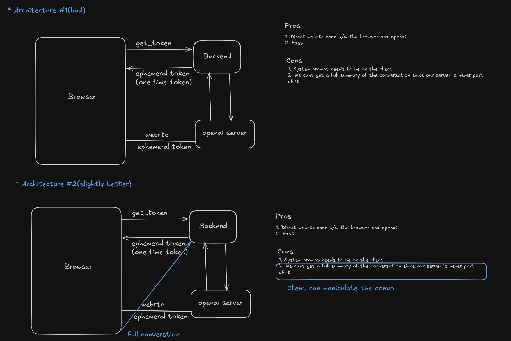
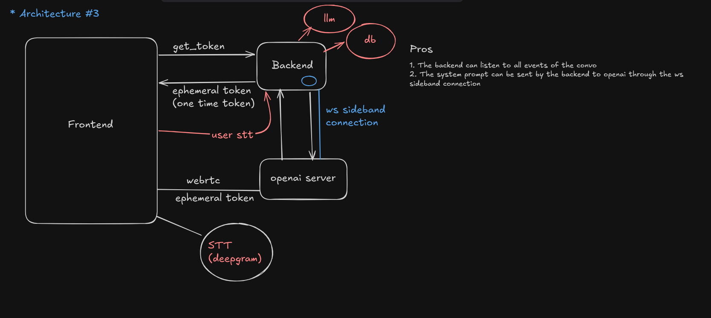

# AI Interviewer

Practice interviews out loud with an AI interviewer that reads your resume, asks about *your* projects, and gives feedback that quotes your own answers. Free, English only.

| | |
|---|---|
| **Live app** | https://ai-interviewer-five-black.vercel.app |
| **API** | https://asdfsdaf.duckdns.org ([health](https://asdfsdaf.duckdns.org/ready), [docs](https://asdfsdaf.duckdns.org/docs)) |

It runs on free tiers, so **one interview at a time**. If the rooms are full, try again in a few minutes.

## What it does

1. **Upload a resume** (text PDF): parsed into structured data.
2. **Start an interview**, with or without a job description. With one, you also get a match score, missing skills and stronger resume bullets.
3. **Talk.** The interviewer asks resume and role questions, follows up on vague answers, and stops when you say "let's stop" or click End.
4. **Read the report.** Competency scores tied to quotes you actually said, a score and a model answer for every question, and speaking metrics (pace, fillers).

## Architecture

```
Browser (Next.js 16, Vercel) ── HTTPS ──► FastAPI (Oracle free VM, behind Caddy)
  mic → Silero VAD            ── WSS ───►  ├─ interview state machine: code owns the structure, the model writes the words
  gapless audio queue                      ├─ Groq: gpt-oss-120b (plans, reports), gpt-oss-20b (live), Whisper large-v3
                                           ├─ Piper TTS in-process (Kokoro optional on bigger machines)
                                           ├─ Postgres job queue (outbox + SKIP LOCKED) for reports
                                           └─► Supabase Postgres (RLS on, Mumbai) + Auth (JWT verified locally)
```

| Layer | Choice |
|---|---|
| Web | Next.js 16, TypeScript, Tailwind v4, shadcn/ui, CSP + HSTS |
| API | FastAPI, Python 3.12, asyncpg, Pydantic |
| AI | Groq (LLM and Whisper), optional second provider, optional LangGraph report engine |
| Speech | Silero VAD in the browser, Piper (1 CPU) or Kokoro (4 CPUs) on the server |
| Data | Supabase Postgres, row-level security, composite foreign keys for ownership |
| Ops | systemd + Caddy, `/ready`, backup script with a tested restore, keep-alive, optional Sentry |

Every decision, with what was chosen, why and what was given up, is in **[`projectprep.md`](projectprep.md)** (D1 to D50).

<details>
<summary><b>How one turn works</b> (sequence diagram)</summary>

The candidate hears an acknowledgement almost at once, and each sentence of the reply is spoken while the model is still writing the rest.



</details>

<details>
<summary><b>The whole interview</b> (code owns the structure)</summary>

The model can only choose between a follow-up and moving on, inside what the code allows. The next planned question is always spoken word for word. Ending queues the report job in the same database transaction, so a report is never lost.



</details>

<details>
<summary><b>The report pipeline</b> (optional LangGraph engine)</summary>

A [LangGraph](https://langchain-ai.github.io/langgraph/) graph can build the report: scoring and per-question review run in parallel, code verifies every quote and score, and a last small call writes the summary from verified results only (D38). Switch with `REPORT_ENGINE=single|graph`. **`single` is the default**: measured on the same interview it was faster (7 s against 10 to 14 s) ([benchmark](docs/benchmarks/report-engines-2026-10-29.md)). LangGraph is not used in the live interview, on purpose (D35).



</details>

## Design exploration

Before writing code I sketched the options for a voice interviewer. These are the early sketches, kept because they show the trade-offs behind the decisions in [`projectprep.md`](projectprep.md). **They are not the final architecture** (that is the diagram above); several of the services drawn here were deliberately not used.

**1. Two ways to build a voice agent.** A *cascade* (speech-to-text, then a language model, then text-to-speech: slower, cheaper, flexible) or a single *voice model* (faster, more expensive).
We built the **cascade**, because it runs on free tiers and lets code control the interview. The latency cost is recovered by speaking each sentence while the model is still writing the next one (D8, D23).



**2. Letting the browser talk to a realtime provider directly.** Fast, but the system prompt has to live on the client, the server never sees the conversation, and the client can manipulate it (the sketch marks both as problems).



**3. Keeping the backend in the loop.** A sideband connection lets the backend see every event, hold the prompt and save the conversation.
This is the idea the final design kept: **our backend owns the whole conversation**. The browser sends one finished answer over a WebSocket, not WebRTC (D3), and the server holds the plan, the prompts and every saved turn, so the client cannot change them.



What was chosen instead of the services in the sketches: Groq Whisper for speech-to-text, `gpt-oss-20b` for live turns, Piper or Kokoro for speech, all on free tiers. Deepgram, ElevenLabs and OpenAI's realtime API were considered and not used.

## Engineering highlights (all measured; see [`docs/benchmarks/`](docs/benchmarks/))

- **Speech on 1 CPU:** Piper makes a 17-word sentence in 0.94 s on the free VM, against 2.8 s for Kokoro on 4 CPUs (D47).
- **Capacity is measured, not guessed:** Kokoro slows in direct proportion to simultaneous interviews, so the live-interview cap is set from a benchmark (D42).
- **Latency by region:** moving the database next to the API cut a query from 146 ms to 4 ms; web functions pinned to the same region (D49).
- **Honest grading:** a strong score needs a quote the candidate really said, checked by code; summaries are written from verified results only (D37).
- **Reliability:** report jobs survive restarts (outbox + `SKIP LOCKED`), the browser reconnects after a deploy, rate limits are waited out, and backups were restored into a scratch database to prove they work.
- **Tests:** 248 API tests with fakes plus a real Postgres, browser end-to-end tests, CI on every push.

## Run locally

Requires Python 3.12 + [uv](https://docs.astral.sh/uv/), Node 22+, Docker.

```bash
docker compose -f infra/docker-compose.yml up -d              # Postgres for the tests
docker compose -f infra/docker-compose.yml --profile speech up -d   # optional: Kokoro voice, ~3 GB

cd apps/api && cp .env.example .env     # GROQ_API_KEY, SUPABASE_URL, DATABASE_URL
uv sync && uv run uvicorn app.main:app --reload        # http://localhost:8000/docs

cd apps/web && cp .env.example .env.local   # Supabase URL + publishable key, API URL
npm install && npm run dev                  # http://localhost:3000
```

- No Kokoro? Set `TTS_ENGINE=piper` (`uv sync --extra piper`, `scripts/get-piper-voice.sh`). With neither, the browser's own voice reads the questions.
- Migrations: `bash scripts/db-push.sh` (`--dry-run` first). Regenerate web types after API changes: `npm run gen:api`.
- Supabase login: add `http://localhost:3000/auth/callback` to Redirect URLs; enable Google if you want it.

## Tests

| Suite | Command |
|---|---|
| API | `cd apps/api && uv run pytest` (needs the local Postgres above) |
| API lint | `uv run ruff check && uv run ruff format --check` |
| Web | `cd apps/web && npx tsc --noEmit && npm run lint && npm run test:unit && npm run build` |
| End to end | `cd apps/web && npm run e2e` (running stack and Supabase keys, see `e2e/support.ts`) |

## Deploy and operate

[`docs/deploy.md`](docs/deploy.md) (Oracle VM, Vercel, backups, monitoring) · [`docs/launch.md`](docs/launch.md) (launch checklist)

## Not built yet

- **Interrupting the interviewer** (barge-in): the microphone is closed while the interviewer speaks (D28).
- A local speech-to-text fallback (`faster-whisper`): the fallback today is a hosted OpenAI-style endpoint.
- Reading image-only parts of a resume PDF (OCR), and languages other than English.
